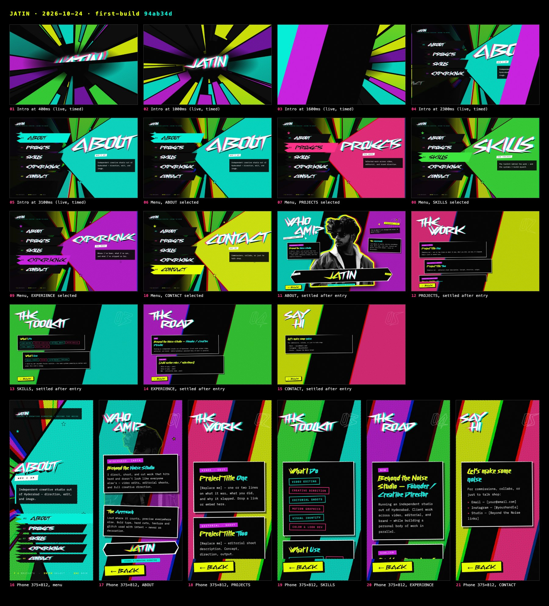

# JATIN — the making of

Jatin's portfolio, built as a game menu instead of a website. Oldest first.
Each chapter: the brief, his notes in his own words, what was built, what was
cut and why. Stills live in [stills/](stills/).

Dates: the first commit is 2026-10-24; the reference recordings are from
August 2026. Rounds between those weren't dated individually — they're grouped
by piece and marked "Oct 2026".

---

## 0 · The idea (Aug 2026)

Two references, merged on purpose:

1. **His own JATIN logo animation** — gives the whole visual language: acid
   yellow, cyan, magenta, purple, green, pink on pure black; shards radiating
   from centre; halftone; chromatic glitch.
2. **A Persona 5 Royal game menu** — gives the interaction: one screen, items
   you select, sections that slam open over it.

So: not a scrolling site. A title sequence, then a menu.
References: [`docs/site/reference/`](../site/reference/).

---

## 1 · First build (2026-10-24)

Stills: [stills/2026-10-24-first-build](stills/2026-10-24-first-build/) (shot
afterwards from commit `94ab34d`).

- Intro: a beat-for-beat recreation of his logo video — shard field strobing,
  wordmark in the centre.
- Menu: five plates (ABOUT, PROJECTS, SKILLS, EXPERIENCE, CONTACT) and the
  giant accent wedge with the selected word slammed across it.
- Sections: tilted headings over two clashing colour bands, cards.
- The ABOUT portrait: his photo, background removed with Apple Vision
  (`docs/tools/cutout.swift`), pushed to high-contrast B&W.

---

## 2 · Getting the look right (Oct 2026)

The texture rounds — each one a thing he cut:

| What | His note | Why it went |
|---|---|---|
| Vignette | removed it, explicitly | The video stays bright to the edges. The frame never darkens. |
| Grunge / distressed type | cut | Texture should come from the glitch shadow, not eroded letters. |
| Animated glitch, grain jumps | "looks like a problem with a TV" | Idle motion read as a broken screen. Glitch is static now; it only moves on input. |
| Scanlines | cut entirely | Moiréd against the halftone. |
| Halftone as holes punched in black | rejected | Read as a layer on top of everything. Now ink dots on the colour, which vanish into the blacks like real print. |
| 14px square dots | "some pattern" | Now 5px dots at 23° — a fine screenprint screen, never a visible grid. |
| Tight tracking | PROJECTS "reading as one blob" | Cyberway Riders' swashes fuse. Tested .035 / .12 / .16 — .14em it is. |

---

## 3 · The menu becomes Persona 5 Royal (Oct 2026)

- **Staircase plates** from his sketch: each plate bleeds off the left edge,
  each one down is shorter, the right ends cut on one continuous diagonal.
- **Selected plate floods** with its accent on a hard cut, no fade.
- **Chromatic burst** on every selection — the only glitch that moves, and
  only on input.
- **The wedge heading is measured, not guessed.** He asked twice for it to
  fill the space; per-letter guesses left half the wedge empty on wide
  screens.
- **EXPERIENCE removed** (his call). Four items: ABOUT cyan, PROJECTS pink,
  SKILLS green, CONTACT acid.
- **The wedge comes alive**: a flowing dithered gradient inside it. Three
  rounds of his notes:
  1. "not too harsh"
  2. "too subtle, more motion and contrast, keep the smooth blend"
  3. "bands too narrow, make them flowy and wider, add a small dither"

  Then "give it some personality" → the same dither on every solid shape.

---

## 4 · Depth (Oct 2026)

His ask: "more depth, intentionality and personality", from Spider-Verse
references. One vanishing point everything radiates from; a glowing
perspective grid; light streaks with white-hot cores; layers parallaxing at
different depths; the whole world re-tints to the selected item. Motion kept
to a few coherent moves — flow, turn, parallax, burst-on-input. No twinkle,
no flicker.

---

## 5 · The intro, rebuilt (Oct 2026)

New references from him: two pop-art explosion title intros. Brief: explosive
composition, electric colour, comic print textures, chromatic aberration,
aggressive rhythmic motion. Built as one canvas on a 24fps clock, every shape
re-rolling **on 2s** — the stepped cadence is what makes it hit like hand-drawn
impact frames.

The opening took three rounds:

1. Random sparks on a HUD → **"empty and random, no intention."**
2. A neon-outline build → after the break the name vanished and left a black
   screen with lines. His note: the name must never disappear, straight into
   the chaos.
3. **The chained lock-up**: JATIN held in chains, two tugs, the strain, then
   the SNAP *is* the slam. Then "it feels flat — make the chains and name 3D"
   → a real 3D scene (extruded slab, lit chain links) with no library.

---

## 6 · Transitions (Oct 2026)

1. A sliding colour-band wipe → **"just a slide."**
2. A shatter → rejected for **matching outlines, more impact, shorter.**
3. Now: the intro's opening in miniature, half a second. Neon outlines whip
   in, one white impact frame, fills slam, everything retracts the way it came.

---

## 7 · ABOUT becomes a poster (Oct 2026)

His reference: a P5 "KREFTON" poster — "understand and analyse the layout of
the boxes … and execute it". Rebuilt box for box: ransom-note title, portrait
dead centre with a sticker rim, speech bubble, the name on a banner slab.

- The banner as a flared arrow → **"looks like an arrow, make it edgy like
  the reference."** Now an angular slab where every edge kinks.
- The name sat at the bottom of the slab → flagged as misaligned; centred.

---

## 8 · Chains (Oct 2026)

Chains built from the site's own pixel pieces, not real links.

- Menu, round 1: a slow inward spiral fading links in and out → **"slowly come
  out transparency"** — rejected.
- Round 2: a flat ring around the wedge.
- Round 3: traced from his red-line sketch → **"crooked"**, and it started on
  the wrong edge.
- Now: a smooth curve through six points of his second sketch, growing from
  far to near the whole way, recolouring with the selection. Nothing fades.
- ABOUT: chains whip in hard in three steps, then keep scrolling.

---

## 9 · PROJECTS: the computer (Oct 2026)

From his rendered reference: a beige vintage monitor on a desktop base. Built
as one shader, no 3D library, so the site stays a single file.

His notes, in order: "edges too rounded" · "sides should align with the base"
· knobs "pointy — they should be flat-topped cylinders, like buttons" · base
"too plain" (→ vents, power LED, floppy drives) · glass "a little curved, not
too heavy" · then a cinematic lighting reference replaced the print look.

Then step 2:
- It arrives **chained up and breaks out** ("more aggressive, with motion and
  a flash").
- Screen boots into a CLICK ME!! button; click → the camera dollies into the
  glass → **JATIN OS**, a small operating system with his folders (FLUX
  magazines, BTN, OUTSTATION).
- Folder browsing first moved in stepped frames → he read it as lag; now
  smooth eases.
- Performance: he reported loading and animations as laggy → the shader only
  works where the computer is, heavy frames at reduced resolution.

---

## 10 · Where it stands (2026-10-26)

Stills + films: [stills/2026-10-26-current](stills/2026-10-26-current/) —
intro beat by beat, the four menu states, a transition, every section, the
PROJECTS entrance and OS, phone layouts. Films: the whole intro at 24fps, a
transition at 60fps, the PROJECTS entrance at 30fps.

Open: his real logo export, real CONTACT links, folder contents for JATIN OS,
deploy.

---

<!-- New chapters go below. Each: ## N · Title (date) · stills link · his
     notes in his words · what was built · what was cut and why. -->
