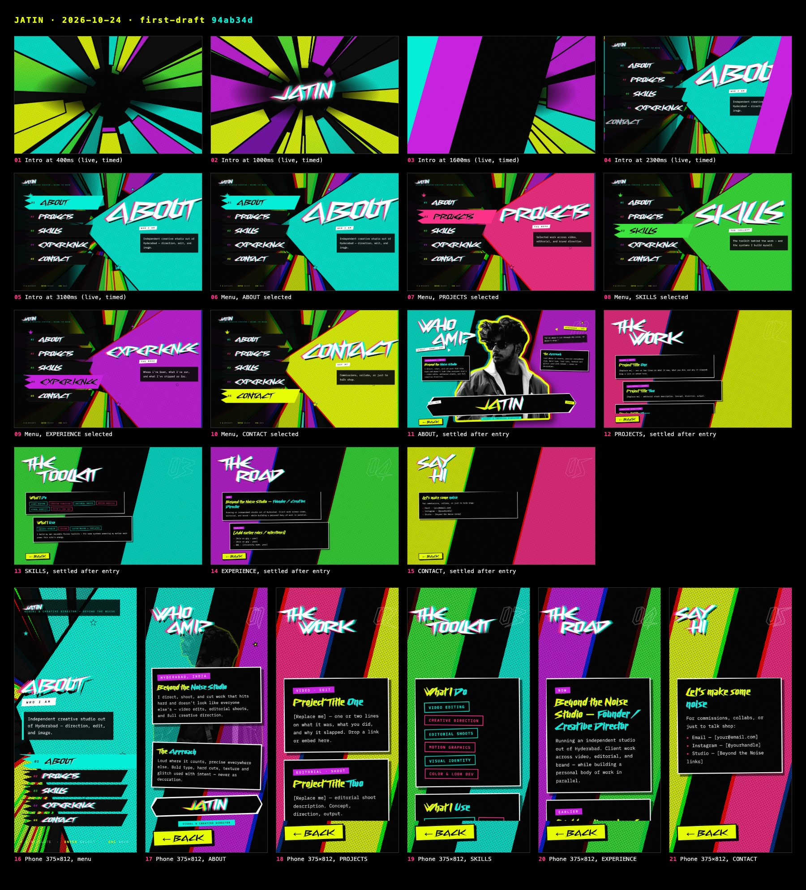
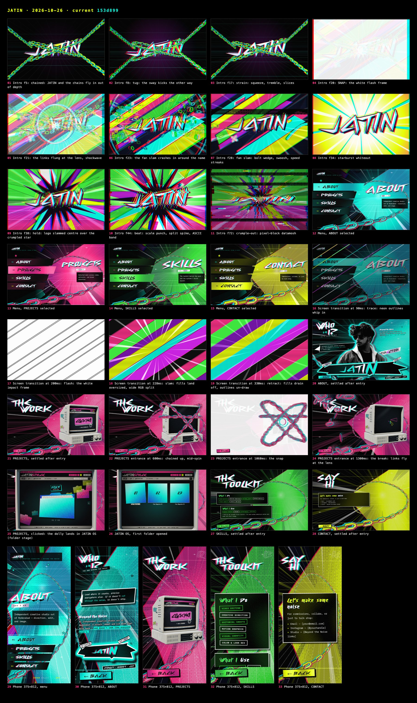

# JATIN — the making of

Jatin's portfolio, built as a game menu instead of a website. Oldest first.
Each chapter: the brief, his notes in his own words, what was built, what was
cut and why. Stills live in [stills/](stills/).

Dates: the first commit is 2026-10-24; the reference recordings are from
August 2026. Rounds between those weren't dated individually — they're grouped
by piece and marked "Oct 2026".

---

## 0 · The idea (Aug 2026)

Two references, merged on purpose:

1. **His own JATIN logo animation** — gives the whole visual language: acid
   yellow, cyan, magenta, purple, green, pink on pure black; shards radiating
   from centre; halftone; chromatic glitch.
2. **A Persona 5 Royal game menu** — gives the interaction: one screen, items
   you select, sections that slam open over it.

So: not a scrolling site. A title sequence, then a menu.
References: [`docs/site/reference/`](../site/reference/).

---

## 1 · The first draft (2026-10-24)

Stills: [stills/2026-10-24-first-draft](stills/2026-10-24-first-draft/) (shot
afterwards from commit `94ab34d`).

His framing: this is **the first draft — the foundation everything after was
built on top of.** Not a throwaway: the palette, the shard field, the menu
model, the wedge and the portrait all start here, and every chapter below
reworks one of these pieces.

- Intro: a beat-for-beat recreation of his logo video — shard field strobing,
  wordmark in the centre.
- Menu: five plates (ABOUT, PROJECTS, SKILLS, EXPERIENCE, CONTACT) and the
  giant accent wedge with the selected word slammed across it.
- Sections: tilted headings over two clashing colour bands, cards.
- The ABOUT portrait: his photo, background removed with Apple Vision
  (`docs/tools/cutout.swift`), pushed to high-contrast B&W.

---

## 2 · Getting the look right (Oct 2026)

The texture rounds — each one a thing he cut:

| What | His note | Why it went |
|---|---|---|
| Vignette | removed it, explicitly | The video stays bright to the edges. The frame never darkens. |
| Grunge / distressed type | cut | Texture should come from the glitch shadow, not eroded letters. |
| Animated glitch, grain jumps | "looks like a problem with a TV" | Idle motion read as a broken screen. Glitch is static now; it only moves on input. |
| Scanlines | cut entirely | Moiréd against the halftone. |
| Halftone as holes punched in black | rejected | Read as a layer on top of everything. Now ink dots on the colour, which vanish into the blacks like real print. |
| 14px square dots | "some pattern" | Now 5px dots at 23° — a fine screenprint screen, never a visible grid. |
| Tight tracking | PROJECTS "reading as one blob" | Cyberway Riders' swashes fuse. Tested .035 / .12 / .16 — .14em it is. |

---

## 3 · The menu becomes Persona 5 Royal (Oct 2026)

- **Staircase plates** from his sketch: each plate bleeds off the left edge,
  each one down is shorter, the right ends cut on one continuous diagonal.
- **Selected plate floods** with its accent on a hard cut, no fade.
- **Chromatic burst** on every selection — the only glitch that moves, and
  only on input.
- **The wedge heading is measured, not guessed.** He asked twice for it to
  fill the space; per-letter guesses left half the wedge empty on wide
  screens.
- **EXPERIENCE removed** (his call). Four items: ABOUT cyan, PROJECTS pink,
  SKILLS green, CONTACT acid.
- **The wedge comes alive**: a flowing dithered gradient inside it. Three
  rounds of his notes:
  1. "not too harsh"
  2. "too subtle, more motion and contrast, keep the smooth blend"
  3. "bands too narrow, make them flowy and wider, add a small dither"

  Then "give it some personality" → the same dither on every solid shape.

---

## 4 · Depth (Oct 2026)

His ask: "more depth, intentionality and personality", from Spider-Verse
references. One vanishing point everything radiates from; a glowing
perspective grid; light streaks with white-hot cores; layers parallaxing at
different depths; the whole world re-tints to the selected item. Motion kept
to a few coherent moves — flow, turn, parallax, burst-on-input. No twinkle,
no flicker.

---

## 5 · The intro, rebuilt (Oct 2026)

New references from him: two pop-art explosion title intros. Brief: explosive
composition, electric colour, comic print textures, chromatic aberration,
aggressive rhythmic motion. Built as one canvas on a 24fps clock, every shape
re-rolling **on 2s** — the stepped cadence is what makes it hit like hand-drawn
impact frames.

The opening took three rounds:

1. Random sparks on a HUD → **"empty and random, no intention."**
2. A neon-outline build → after the break the name vanished and left a black
   screen with lines. His note: the name must never disappear, straight into
   the chaos.
3. **The chained lock-up**: JATIN held in chains, two tugs, the strain, then
   the SNAP *is* the slam. Then "it feels flat — make the chains and name 3D"
   → a real 3D scene (extruded slab, lit chain links) with no library.

---

## 6 · Transitions (Oct 2026)

1. A sliding colour-band wipe → **"just a slide."**
2. A shatter → rejected for **matching outlines, more impact, shorter.**
3. Now: the intro's opening in miniature, half a second. Neon outlines whip
   in, one white impact frame, fills slam, everything retracts the way it came.

---

## 7 · ABOUT becomes a poster (Oct 2026)

His reference: a P5 "KREFTON" poster — "understand and analyse the layout of
the boxes … and execute it". Rebuilt box for box: ransom-note title, portrait
dead centre with a sticker rim, speech bubble, the name on a banner slab.

- The banner as a flared arrow → **"looks like an arrow, make it edgy like
  the reference."** Now an angular slab where every edge kinks.
- The name sat at the bottom of the slab → flagged as misaligned; centred.

---

## 8 · Chains (Oct 2026)

Chains built from the site's own pixel pieces, not real links.

- Menu, round 1: a slow inward spiral fading links in and out → **"slowly come
  out transparency"** — rejected.
- Round 2: a flat ring around the wedge.
- Round 3: traced from his red-line sketch → **"crooked"**, and it started on
  the wrong edge.
- Now: a smooth curve through six points of his second sketch, growing from
  far to near the whole way, recolouring with the selection. Nothing fades.
- ABOUT: chains whip in hard in three steps, then keep scrolling.

---

## 9 · PROJECTS: the computer (Oct 2026)

From his rendered reference: a beige vintage monitor on a desktop base. Built
as one shader, no 3D library, so the site stays a single file.

His notes, in order: "edges too rounded" · "sides should align with the base"
· knobs "pointy — they should be flat-topped cylinders, like buttons" · base
"too plain" (→ vents, power LED, floppy drives) · glass "a little curved, not
too heavy" · then a cinematic lighting reference replaced the print look.

Then step 2:
- It arrives **chained up and breaks out** ("more aggressive, with motion and
  a flash").
- Screen boots into a CLICK ME!! button; click → the camera dollies into the
  glass → **JATIN OS**, a small operating system with his folders (FLUX
  magazines, BTN, OUTSTATION).
- Folder browsing first moved in stepped frames → he read it as lag; now
  smooth eases.
- Performance: he reported loading and animations as laggy → the shader only
  works where the computer is, heavy frames at reduced resolution.

---

## 10 · Where it stands (2026-10-26)

Stills + films: [stills/2026-10-26-current](stills/2026-10-26-current/) —
intro beat by beat, the four menu states, a transition, every section, the
PROJECTS entrance and OS, phone layouts. Films: the whole intro at 24fps, a
transition at 60fps, the PROJECTS entrance at 30fps.

Open: his real logo export, real CONTACT links, folder contents for JATIN OS,
deploy.

---

<!-- New chapters go below. Each: ## N · Title (date) · stills link · his
     notes in his words · what was built · what was cut and why. -->

## 11 · The chained intro goes 3D, then floats (2026-10-26)

Before: [stills/2026-10-26-3d-chains-bulge](stills/2026-10-26-3d-chains-bulge/) ·
After: [stills/2026-10-26-3d-chains-zero-g](stills/2026-10-26-3d-chains-zero-g/)

His notes, in order:
- "do the same chain break with the website intro, JATIN chained, then the
  aggressive break unleashes the animation" → ported from the PROJECTS computer.
- "i want the chains and name logo to be 3d … after the break i don't want the
  name to disappear, continue with the chaos" → WebGL slab + links; the snap
  lands on the fan slam's crash frame.
- "the logo and the side chains connected at all times until the break; the
  top-left chain isn't in the corner like the others; chain texture the same
  as the 2d chains" → four mirrored anchors, pixel-stepped chain layer.
- "i do like logo being chained up, don't remove that. shape like the 2d chain
  first, then texture on top — dithering instead of halftone, don't touch the
  colours" → X straps back; flat ring/bar plates; Bayer dither.
- "the chains on the logo are bulging, it should be closer to the logo model as
  it is stuck to it" → straps hug the slab (the rejected state is the
  `3d-chains-bulge` set).
- "in the start the chains float like zero gravity, then suddenly and quickly
  tighten up and the break happens — more depth" → slack S-curve paths, a
  1.4-frame yank, chained phase 18 → 26 frames.

Cut: the neon-outline build (the name vanished into black); tube links and
smooth toon lighting (read as a different chain).

Round 2 (same day), his notes: "a bit too flowy for my taste … slow during the
floating part, then from the moment the chains pull the logo it bursts out …
the pull needs more weight, when it's completely pulled out a small shake to
add impact." → slack amplitude nearly halved and the drift slowed to a crawl;
yank down to one frame; a damped thud rings through camera, word and chains
once taut, before the strain builds to the snap.

Round 3: "that looks good now — make this part (the break and the chaos after it)
just 2.5 seconds long, since we're giving more time at the start." Snap → hand-off
was 2.33s; the hold now runs 4 frames longer so it is exactly 2.5s (60 frames).
Intro total: 88 frames = 3.67s.

Round 4 (what he meant by "this part"): "the burst animation — only 2 seconds
long max, shorter, so the intro isn't too long since we're giving more time to
the chain break scene." Burst = snap → hand-off, now 48 frames = 2.0s; the
hold lost 12 frames (three beats instead of four, the last one landing right
on the crumple). Intro total 76 frames = 3.17s — the same length as before the
chained opening grew, so the extra float time costs nothing overall.

Round 5: "still feels long — shorter, a bit quicker; don't touch the chain break
(its length stays)." The chained opening and the snap are untouched; the burst
went 48 → 36 frames (1.5s): the hold is 14 frames with two beats (the first
lands 4 frames after the starburst, the second right before the crumple)
instead of 26 frames and three. Intro total 64 frames = 2.67s.

Round 6: "ok nvm, let's stick with 2.5 seconds." Back to the round-3 burst: 60
frames (2.5s) from the snap, hold of 38 frames with beats every 8 from f52,
intro total 88 frames = 3.67s. The 2.0s and 1.5s cuts (rounds 4–5) were tried
and dropped.

Round 7: "let's actually keep it at 1.85 secs — the sweet spot." Burst = 44 frames
(1.83s, kept even so the on-2s cadence holds): hold of 22 frames with three
beats at 180bpm (the last two frames before the crumple), crumple 6 frames.
Intro total 72 frames = 3.0s. This is the setting he settled on after 2.5s,
2.0s and 1.5s were tried.

Round 8: "i love it now — keep the first 3D floating part floating until the
user clicks any button to start the animation, with a click-any-button text
underneath the logo with a subtle blink like video games." → the intro waits
at the yank (float keeps drifting on its own clock) with a blinking PRESS ANY
BUTTON under the word; any press fires the yank → break → burst. Tooling that
drives the live intro now has to press a key.

Round 9: "why is there extra chain spiking up like that around the logo? fix
anything like it. and change the text font to something like [a pixel face]."
→ the strap loops' tilted ends stuck out past the letters as horns; flattened
the X (±.2 rad, shorter) so they stay inside the silhouette, and the slack
anchors now leave the word gently instead of kinking. Prompt is VT323 and
reads CLICK ANY BUTTON (his words).

Round 10: "text a bit smaller, and the blinking subtler." → ~60% of the size;
blink now 1 ↔ .5 opacity on a 1.5s step instead of full on/off.

Round 11: "the halftone on the chains in the website looks too much like overlay
rather than a texture, and it's a bit too big." → ChainFX dots halved in pitch,
clipped to each link's face (off the ink rule and the red/cyan fringe) and made
tonal — they swell with the gradient's shade and fade out in the highlight.

## Chapter 12 — ABOUT becomes a poster ("Have you seen this DIRECTOR?")

His words: "I want the about page to be designed like this but obviously
keeping my design language. I want you to particularly observe the text
placement, how it is scaled and the perspective changes. And replace my image
with the one I uploaded."

Built: two kinked wedge banners (pink top, purple bottom) holding a headline
that grows 1× → 1.8× → 2.6× and leans into perspective; a punchline that does
the same at the bottom ("IT DOESN'T SHIP." — his own line turned into the
poster's gag); the new night photo cut with Vision and graded to the site's B&W
print look, rimmed in cyan; bubble, sparkles and chains behind. Cut: the P5
KREFTON collage with the name slab (stills kept in `about-p5-kreften`).
Audit fixes: sparkle moved off the bubble copy on short screens; phone BACK was
sitting on the punchline; the 4px glitch split doubled small type.
Stills: `about-poster-v1`, `about-poster-short`, `about-poster-laptop`.

Round 2 (his notes): the photo felt small against the big bars, the black gap
above the top banner bothered him, and BACK sat on the purple bar. "For now
just remove all the text from top and bottom so we can figure out the
alignment." → text out, bars flush and thinner, portrait ~14% bigger, BACK
moved to the top-left. Stills: `about-notext`.

Round 3 (his notes, with a red/black marked-up screenshot): top bar covers to
the top edge, photo sits ABOVE the top bar and BELOW the bottom one at the scale
of the poster crop, bars were "leaving a lot of empty space", and he sketched
the big punchline in the bottom right. → text back at fill size, bars reshaped
to his lines, portrait re-layered and rescaled. Stills: `about-layout`.

Round 4 (his notes): the crop "looks very unnatural", and the outline "looks
like a sketch pen — make it fade outwards using cyan and hot pink." → new
matte (colour-keyed hair on a 2x upscale, decontaminated edge) and a neon halo
instead of the stamped outline. Stills: `about-glow`; the old look is in
`about-before-glow`.

Round 5 (his notes, green lines on a screenshot): chains should replace the
pink and purple bars' edges, straight, scrolling forever. → two canvases, one
per banner, path read from the banner's own edge. Stills: `about-edge-chains`.

## Chapter 13 — The work goes on the computer (2026-10-30)

A Vogue position opened. His plan: "keep the intro video and rather than opening
menu screen … go directly to projects menu, to show my work immediately." →
apply mode (`APPLY=true`): the intro's last slam cuts to PROJECTS, and the menu
and BACK step aside. Nothing deleted; "REVERT MAIN" brings the full site back.
Stills: `apply-mode-2`.

Round 1 (his screen recording): "when return from the folder there is a weird
animation." The folder pulled back, held open, then blinked out and slid in
again: the browse slide-in was replaying under the pull-back. → cleared.

Round 2: his BEST folder (Mag 1/2/3, Outstation) into the OS, plus tests that it
holds up when hosted. → `docs/tools/photos.mjs` (sRGB, three sizes, no camera
or GPS data; 200MB of sources → 39MB). The OS goes FLUX → magazine covers →
photo grid → viewer, and OUTSTATION opens straight to its grid. The photos show
clean in the viewer: the tube's scanlines step aside for the work.

Round 3: "make the computer screen fullscreen when it comes close so that it's
easier for people to view my work … zoom into the photos and drag and stuff to
have some freedom." → the tube powers on on the glass, then grows off it to
fill the page; EXIT shrinks it back first. The viewer zooms where you point
(scroll, pinch, double-click) and drags, loading a 3000px frame on first zoom.
Stills: `os-gallery`.

**BACK and EXIT (Oct 30, late).** His note, with a box drawn at the stage's
top-left: "add a back button at the place i outlined … so the users can go
back from folder to folder and making the top exit button as exiting the
computer directly." → a `◀ BACK` plate in the folder's colour sits there and
climbs one level per press (photo → grid → covers → folders), the same as
Esc. On the folder stage there's nothing above, so it dims out rather than
vanishing; the spot stays put. The header's `[X] EXIT` leaves the computer
from any depth, even from inside a photo. Stills: `os-back`.

**Clean photos (same night).** "could u remove the scanlines on the photos as
well" → the tube's scanlines now drop the moment you're inside a folder
(covers, photo grid, viewer), not only in the viewer. The folder stage keeps
them, so the computer still feels like a computer until the work is up.
Before: `os-back` (grid still lined). After: `os-clean-photos`.

**Phones get their own instructions (same night).** "this commands only work
for laptop or pc but not for people who open up phones … is it possible for
the commands to change based on the device … and also make the navigation
around the files and computer easier" →
- The HOW TO USE bar speaks the device: touch screens get "swipe or ◀ ▶ to
  browse · tap the folder to open", "tap a photo to view it · BACK goes up",
  "swipe for next · pinch to zoom · double-tap to fit · swipe down to close".
  Laptops keep the keys. The computer's own screen says "tap the computer to
  switch it on" on a phone.
- BACK names where it goes: ◀ FOLDERS, ◀ FLUX, ◀ MAGAZINE 01. On a phone the
  path is hidden, so this is how you know where you are.
- The path on laptops is now a set of links: click JATINSPACE or FLUX to jump
  straight up.
- Swipe down on a photo closes it, the way phones expect.
Stills: `os-touch-nav`.

**Straight to the work (Oct 31).** "inside flux folder i think you should
just remove folders show the photos directly. and add tabs on top … one tab
photo and other being edits." → FLUX opens onto all 40 photos in one grid
(Magazine 01 → 02 → 03), with PHOTOS and EDITS tabs beside BACK: the open
one filled pink, the other outlined. EDITS shows [ EMPTY ] until his edits
arrive. The magazine covers are cut; before: `os-covers-before-tabs`,
after: `flux-tabs`.

## 2026-10-31 — OS buttons become menu plates
His note: "i dont like these button design could u make something with our menu
button design something similar." The outlined boxes (FOLDERS, PHOTOS, EDITS)
were swapped for the menu's slanted black plates: Cyberway, glitch split,
numbered, dithered, flooding the folder colour on select with the menu's
chroma burst. Stills: `stills/2026-10-31-os-plates/`.

## 2026-10-31 — his edits go into the computer
His ask: "this folder contains all the video edits there is also an outstation
video that i want in the outstation folder ofc." Seven FLUX films go under
FLUX › EDITS and the outstation film under a new OUTSTATION › EDITS tab. Poster
grid with pink play plates and run times; tapping one plays it in the viewer
with sound. Encoded down to 1080 for the web (233MB for all eight). Caught in
testing: Safari drew the posters at a third of their width, and wouldn't play
video from the local test server (needs byte ranges) — both fixed.
Stills: `stills/2026-10-31-os-edits/`.

## 2026-10-31 — one way out
His note: "remove exit altogether and let back button exit the monitor screen
thats better and simple." EXIT cut from the OS header; BACK walks up one level
at a time and, from the folders, leaves the computer.
Stills: `stills/2026-10-31-os-no-exit/`.

## 2026-10-31 — five strangers try the site
His ask: act as launch QA. Five first-time visitors, each a different kind of
person (impatient skimmer, skeptical recruiter, phone on slow 3G, a literal
non-native reader, someone trying to break it), each going from the intro to
seeing one of his photos full-size, screenshotting every snag. Then fix, then
send them all back in.
- What they all hit: there is no way to contact him (his call: leave it for
  now) and the browser/phone Back button threw them off the site.
- Fixed: Back now climbs the computer one level at a time; a click on the
  computer while it's still chained is kept (Esc takes it back); a LOADING
  line shows in the 13s of black on slow 3G; the full photo loads before
  anything else; search says NO MATCH; LAST UPDATED is the real publish date;
  link previews; touch targets; the help names the BACK plate you can see.
- Round 2 caught one of our own: a touch pad under the OUTSTATION link let a
  near-miss land on BACK and close the computer. Replaced with real padding.
- Left as his decisions: contact/about, credits on the work, "CLICK ANY
  BUTTON", the BTN sticker, the intro can't be skipped.
Stills: `stills/2026-10-31-first-user-qa/` (before and after).
