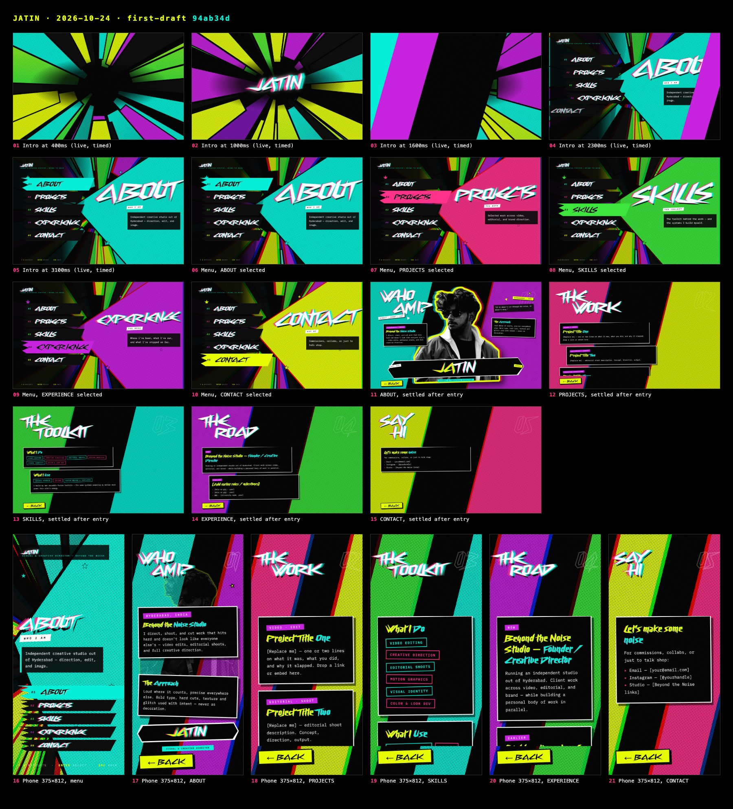
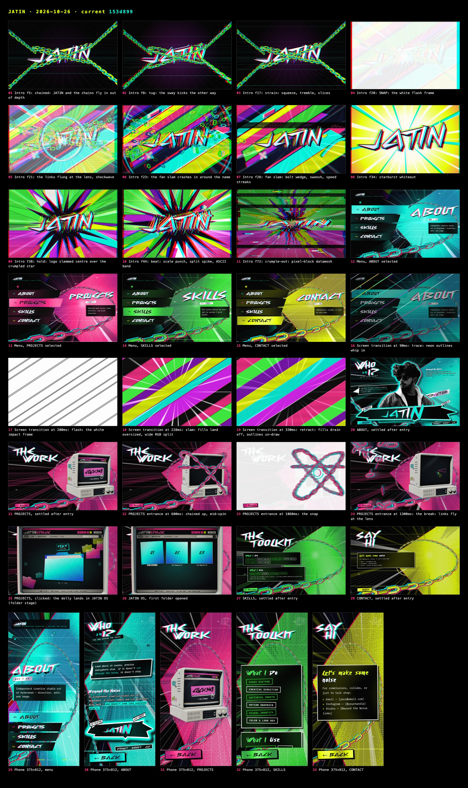

# JATIN — the making of

Jatin's portfolio, built as a game menu instead of a website. Oldest first.
Each chapter: the brief, his notes in his own words, what was built, what was
cut and why. Stills live in [stills/](stills/).

Dates: the first commit is 2026-10-24; the reference recordings are from
August 2026. Rounds between those weren't dated individually — they're grouped
by piece and marked "Oct 2026".

---

## 0 · The idea (Aug 2026)

Two references, merged on purpose:

1. **His own JATIN logo animation** — gives the whole visual language: acid
   yellow, cyan, magenta, purple, green, pink on pure black; shards radiating
   from centre; halftone; chromatic glitch.
2. **A Persona 5 Royal game menu** — gives the interaction: one screen, items
   you select, sections that slam open over it.

So: not a scrolling site. A title sequence, then a menu.
References: [`docs/site/reference/`](../site/reference/).

---

## 1 · The first draft (2026-10-24)

Stills: [stills/2026-10-24-first-draft](stills/2026-10-24-first-draft/) (shot
afterwards from commit `94ab34d`).

His framing: this is **the first draft — the foundation everything after was
built on top of.** Not a throwaway: the palette, the shard field, the menu
model, the wedge and the portrait all start here, and every chapter below
reworks one of these pieces.

- Intro: a beat-for-beat recreation of his logo video — shard field strobing,
  wordmark in the centre.
- Menu: five plates (ABOUT, PROJECTS, SKILLS, EXPERIENCE, CONTACT) and the
  giant accent wedge with the selected word slammed across it.
- Sections: tilted headings over two clashing colour bands, cards.
- The ABOUT portrait: his photo, background removed with Apple Vision
  (`docs/tools/cutout.swift`), pushed to high-contrast B&W.

---

## 2 · Getting the look right (Oct 2026)

The texture rounds — each one a thing he cut:

| What | His note | Why it went |
|---|---|---|
| Vignette | removed it, explicitly | The video stays bright to the edges. The frame never darkens. |
| Grunge / distressed type | cut | Texture should come from the glitch shadow, not eroded letters. |
| Animated glitch, grain jumps | "looks like a problem with a TV" | Idle motion read as a broken screen. Glitch is static now; it only moves on input. |
| Scanlines | cut entirely | Moiréd against the halftone. |
| Halftone as holes punched in black | rejected | Read as a layer on top of everything. Now ink dots on the colour, which vanish into the blacks like real print. |
| 14px square dots | "some pattern" | Now 5px dots at 23° — a fine screenprint screen, never a visible grid. |
| Tight tracking | PROJECTS "reading as one blob" | Cyberway Riders' swashes fuse. Tested .035 / .12 / .16 — .14em it is. |

---

## 3 · The menu becomes Persona 5 Royal (Oct 2026)

- **Staircase plates** from his sketch: each plate bleeds off the left edge,
  each one down is shorter, the right ends cut on one continuous diagonal.
- **Selected plate floods** with its accent on a hard cut, no fade.
- **Chromatic burst** on every selection — the only glitch that moves, and
  only on input.
- **The wedge heading is measured, not guessed.** He asked twice for it to
  fill the space; per-letter guesses left half the wedge empty on wide
  screens.
- **EXPERIENCE removed** (his call). Four items: ABOUT cyan, PROJECTS pink,
  SKILLS green, CONTACT acid.
- **The wedge comes alive**: a flowing dithered gradient inside it. Three
  rounds of his notes:
  1. "not too harsh"
  2. "too subtle, more motion and contrast, keep the smooth blend"
  3. "bands too narrow, make them flowy and wider, add a small dither"

  Then "give it some personality" → the same dither on every solid shape.

---

## 4 · Depth (Oct 2026)

His ask: "more depth, intentionality and personality", from Spider-Verse
references. One vanishing point everything radiates from; a glowing
perspective grid; light streaks with white-hot cores; layers parallaxing at
different depths; the whole world re-tints to the selected item. Motion kept
to a few coherent moves — flow, turn, parallax, burst-on-input. No twinkle,
no flicker.

---

## 5 · The intro, rebuilt (Oct 2026)

New references from him: two pop-art explosion title intros. Brief: explosive
composition, electric colour, comic print textures, chromatic aberration,
aggressive rhythmic motion. Built as one canvas on a 24fps clock, every shape
re-rolling **on 2s** — the stepped cadence is what makes it hit like hand-drawn
impact frames.

The opening took three rounds:

1. Random sparks on a HUD → **"empty and random, no intention."**
2. A neon-outline build → after the break the name vanished and left a black
   screen with lines. His note: the name must never disappear, straight into
   the chaos.
3. **The chained lock-up**: JATIN held in chains, two tugs, the strain, then
   the SNAP *is* the slam. Then "it feels flat — make the chains and name 3D"
   → a real 3D scene (extruded slab, lit chain links) with no library.

---

## 6 · Transitions (Oct 2026)

1. A sliding colour-band wipe → **"just a slide."**
2. A shatter → rejected for **matching outlines, more impact, shorter.**
3. Now: the intro's opening in miniature, half a second. Neon outlines whip
   in, one white impact frame, fills slam, everything retracts the way it came.

---

## 7 · ABOUT becomes a poster (Oct 2026)

His reference: a P5 "KREFTON" poster — "understand and analyse the layout of
the boxes … and execute it". Rebuilt box for box: ransom-note title, portrait
dead centre with a sticker rim, speech bubble, the name on a banner slab.

- The banner as a flared arrow → **"looks like an arrow, make it edgy like
  the reference."** Now an angular slab where every edge kinks.
- The name sat at the bottom of the slab → flagged as misaligned; centred.

---

## 8 · Chains (Oct 2026)

Chains built from the site's own pixel pieces, not real links.

- Menu, round 1: a slow inward spiral fading links in and out → **"slowly come
  out transparency"** — rejected.
- Round 2: a flat ring around the wedge.
- Round 3: traced from his red-line sketch → **"crooked"**, and it started on
  the wrong edge.
- Now: a smooth curve through six points of his second sketch, growing from
  far to near the whole way, recolouring with the selection. Nothing fades.
- ABOUT: chains whip in hard in three steps, then keep scrolling.

---

## 9 · PROJECTS: the computer (Oct 2026)

From his rendered reference: a beige vintage monitor on a desktop base. Built
as one shader, no 3D library, so the site stays a single file.

His notes, in order: "edges too rounded" · "sides should align with the base"
· knobs "pointy — they should be flat-topped cylinders, like buttons" · base
"too plain" (→ vents, power LED, floppy drives) · glass "a little curved, not
too heavy" · then a cinematic lighting reference replaced the print look.

Then step 2:
- It arrives **chained up and breaks out** ("more aggressive, with motion and
  a flash").
- Screen boots into a CLICK ME!! button; click → the camera dollies into the
  glass → **JATIN OS**, a small operating system with his folders (FLUX
  magazines, BTN, OUTSTATION).
- Folder browsing first moved in stepped frames → he read it as lag; now
  smooth eases.
- Performance: he reported loading and animations as laggy → the shader only
  works where the computer is, heavy frames at reduced resolution.

---

## 10 · Where it stands (2026-10-26)

Stills + films: [stills/2026-10-26-current](stills/2026-10-26-current/) —
intro beat by beat, the four menu states, a transition, every section, the
PROJECTS entrance and OS, phone layouts. Films: the whole intro at 24fps, a
transition at 60fps, the PROJECTS entrance at 30fps.

Open: his real logo export, real CONTACT links, folder contents for JATIN OS,
deploy.

---

<!-- New chapters go below. Each: ## N · Title (date) · stills link · his
     notes in his words · what was built · what was cut and why. -->

## 11 · The chained intro goes 3D, then floats (2026-10-26)

Before: [stills/2026-10-26-3d-chains-bulge](stills/2026-10-26-3d-chains-bulge/) ·
After: [stills/2026-10-26-3d-chains-zero-g](stills/2026-10-26-3d-chains-zero-g/)

His notes, in order:
- "do the same chain break with the website intro, JATIN chained, then the
  aggressive break unleashes the animation" → ported from the PROJECTS computer.
- "i want the chains and name logo to be 3d … after the break i don't want the
  name to disappear, continue with the chaos" → WebGL slab + links; the snap
  lands on the fan slam's crash frame.
- "the logo and the side chains connected at all times until the break; the
  top-left chain isn't in the corner like the others; chain texture the same
  as the 2d chains" → four mirrored anchors, pixel-stepped chain layer.
- "i do like logo being chained up, don't remove that. shape like the 2d chain
  first, then texture on top — dithering instead of halftone, don't touch the
  colours" → X straps back; flat ring/bar plates; Bayer dither.
- "the chains on the logo are bulging, it should be closer to the logo model as
  it is stuck to it" → straps hug the slab (the rejected state is the
  `3d-chains-bulge` set).
- "in the start the chains float like zero gravity, then suddenly and quickly
  tighten up and the break happens — more depth" → slack S-curve paths, a
  1.4-frame yank, chained phase 18 → 26 frames.

Cut: the neon-outline build (the name vanished into black); tube links and
smooth toon lighting (read as a different chain).

Round 2 (same day), his notes: "a bit too flowy for my taste … slow during the
floating part, then from the moment the chains pull the logo it bursts out …
the pull needs more weight, when it's completely pulled out a small shake to
add impact." → slack amplitude nearly halved and the drift slowed to a crawl;
yank down to one frame; a damped thud rings through camera, word and chains
once taut, before the strain builds to the snap.

Round 3: "that looks good now — make this part (the break and the chaos after it)
just 2.5 seconds long, since we're giving more time at the start." Snap → hand-off
was 2.33s; the hold now runs 4 frames longer so it is exactly 2.5s (60 frames).
Intro total: 88 frames = 3.67s.

Round 4 (what he meant by "this part"): "the burst animation — only 2 seconds
long max, shorter, so the intro isn't too long since we're giving more time to
the chain break scene." Burst = snap → hand-off, now 48 frames = 2.0s; the
hold lost 12 frames (three beats instead of four, the last one landing right
on the crumple). Intro total 76 frames = 3.17s — the same length as before the
chained opening grew, so the extra float time costs nothing overall.

Round 5: "still feels long — shorter, a bit quicker; don't touch the chain break
(its length stays)." The chained opening and the snap are untouched; the burst
went 48 → 36 frames (1.5s): the hold is 14 frames with two beats (the first
lands 4 frames after the starburst, the second right before the crumple)
instead of 26 frames and three. Intro total 64 frames = 2.67s.

Round 6: "ok nvm, let's stick with 2.5 seconds." Back to the round-3 burst: 60
frames (2.5s) from the snap, hold of 38 frames with beats every 8 from f52,
intro total 88 frames = 3.67s. The 2.0s and 1.5s cuts (rounds 4–5) were tried
and dropped.

Round 7: "let's actually keep it at 1.85 secs — the sweet spot." Burst = 44 frames
(1.83s, kept even so the on-2s cadence holds): hold of 22 frames with three
beats at 180bpm (the last two frames before the crumple), crumple 6 frames.
Intro total 72 frames = 3.0s. This is the setting he settled on after 2.5s,
2.0s and 1.5s were tried.

Round 8: "i love it now — keep the first 3D floating part floating until the
user clicks any button to start the animation, with a click-any-button text
underneath the logo with a subtle blink like video games." → the intro waits
at the yank (float keeps drifting on its own clock) with a blinking PRESS ANY
BUTTON under the word; any press fires the yank → break → burst. Tooling that
drives the live intro now has to press a key.

Round 9: "why is there extra chain spiking up like that around the logo? fix
anything like it. and change the text font to something like [a pixel face]."
→ the strap loops' tilted ends stuck out past the letters as horns; flattened
the X (±.2 rad, shorter) so they stay inside the silhouette, and the slack
anchors now leave the word gently instead of kinking. Prompt is VT323 and
reads CLICK ANY BUTTON (his words).

Round 10: "text a bit smaller, and the blinking subtler." → ~60% of the size;
blink now 1 ↔ .5 opacity on a 1.5s step instead of full on/off.

Round 11: "the halftone on the chains in the website looks too much like overlay
rather than a texture, and it's a bit too big." → ChainFX dots halved in pitch,
clipped to each link's face (off the ink rule and the red/cyan fringe) and made
tonal — they swell with the gradient's shade and fade out in the highlight.

## Chapter 12 — ABOUT becomes a poster ("Have you seen this DIRECTOR?")

His words: "I want the about page to be designed like this but obviously
keeping my design language. I want you to particularly observe the text
placement, how it is scaled and the perspective changes. And replace my image
with the one I uploaded."

Built: two kinked wedge banners (pink top, purple bottom) holding a headline
that grows 1× → 1.8× → 2.6× and leans into perspective; a punchline that does
the same at the bottom ("IT DOESN'T SHIP." — his own line turned into the
poster's gag); the new night photo cut with Vision and graded to the site's B&W
print look, rimmed in cyan; bubble, sparkles and chains behind. Cut: the P5
KREFTON collage with the name slab (stills kept in `about-p5-kreften`).
Audit fixes: sparkle moved off the bubble copy on short screens; phone BACK was
sitting on the punchline; the 4px glitch split doubled small type.
Stills: `about-poster-v1`, `about-poster-short`, `about-poster-laptop`.

Round 2 (his notes): the photo felt small against the big bars, the black gap
above the top banner bothered him, and BACK sat on the purple bar. "For now
just remove all the text from top and bottom so we can figure out the
alignment." → text out, bars flush and thinner, portrait ~14% bigger, BACK
moved to the top-left. Stills: `about-notext`.

Round 3 (his notes, with a red/black marked-up screenshot): top bar covers to
the top edge, photo sits ABOVE the top bar and BELOW the bottom one at the scale
of the poster crop, bars were "leaving a lot of empty space", and he sketched
the big punchline in the bottom right. → text back at fill size, bars reshaped
to his lines, portrait re-layered and rescaled. Stills: `about-layout`.

Round 4 (his notes): the crop "looks very unnatural", and the outline "looks
like a sketch pen — make it fade outwards using cyan and hot pink." → new
matte (colour-keyed hair on a 2x upscale, decontaminated edge) and a neon halo
instead of the stamped outline. Stills: `about-glow`; the old look is in
`about-before-glow`.

Round 5 (his notes, green lines on a screenshot): chains should replace the
pink and purple bars' edges, straight, scrolling forever. → two canvases, one
per banner, path read from the banner's own edge. Stills: `about-edge-chains`.

## Chapter 13 — The work goes on the computer (2026-10-30)

A Vogue position opened. His plan: "keep the intro video and rather than opening
menu screen … go directly to projects menu, to show my work immediately." →
apply mode (`APPLY=true`): the intro's last slam cuts to PROJECTS, and the menu
and BACK step aside. Nothing deleted; "REVERT MAIN" brings the full site back.
Stills: `apply-mode-2`.

Round 1 (his screen recording): "when return from the folder there is a weird
animation." The folder pulled back, held open, then blinked out and slid in
again: the browse slide-in was replaying under the pull-back. → cleared.

Round 2: his BEST folder (Mag 1/2/3, Outstation) into the OS, plus tests that it
holds up when hosted. → `docs/tools/photos.mjs` (sRGB, three sizes, no camera
or GPS data; 200MB of sources → 39MB). The OS goes FLUX → magazine covers →
photo grid → viewer, and OUTSTATION opens straight to its grid. The photos show
clean in the viewer: the tube's scanlines step aside for the work.

Round 3: "make the computer screen fullscreen when it comes close so that it's
easier for people to view my work … zoom into the photos and drag and stuff to
have some freedom." → the tube powers on on the glass, then grows off it to
fill the page; EXIT shrinks it back first. The viewer zooms where you point
(scroll, pinch, double-click) and drags, loading a 3000px frame on first zoom.
Stills: `os-gallery`.

**BACK and EXIT (Oct 30, late).** His note, with a box drawn at the stage's
top-left: "add a back button at the place i outlined … so the users can go
back from folder to folder and making the top exit button as exiting the
computer directly." → a `◀ BACK` plate in the folder's colour sits there and
climbs one level per press (photo → grid → covers → folders), the same as
Esc. On the folder stage there's nothing above, so it dims out rather than
vanishing; the spot stays put. The header's `[X] EXIT` leaves the computer
from any depth, even from inside a photo. Stills: `os-back`.

**Clean photos (same night).** "could u remove the scanlines on the photos as
well" → the tube's scanlines now drop the moment you're inside a folder
(covers, photo grid, viewer), not only in the viewer. The folder stage keeps
them, so the computer still feels like a computer until the work is up.
Before: `os-back` (grid still lined). After: `os-clean-photos`.

**Phones get their own instructions (same night).** "this commands only work
for laptop or pc but not for people who open up phones … is it possible for
the commands to change based on the device … and also make the navigation
around the files and computer easier" →
- The HOW TO USE bar speaks the device: touch screens get "swipe or ◀ ▶ to
  browse · tap the folder to open", "tap a photo to view it · BACK goes up",
  "swipe for next · pinch to zoom · double-tap to fit · swipe down to close".
  Laptops keep the keys. The computer's own screen says "tap the computer to
  switch it on" on a phone.
- BACK names where it goes: ◀ FOLDERS, ◀ FLUX, ◀ MAGAZINE 01. On a phone the
  path is hidden, so this is how you know where you are.
- The path on laptops is now a set of links: click JATINSPACE or FLUX to jump
  straight up.
- Swipe down on a photo closes it, the way phones expect.
Stills: `os-touch-nav`.

**Straight to the work (Oct 31).** "inside flux folder i think you should
just remove folders show the photos directly. and add tabs on top … one tab
photo and other being edits." → FLUX opens onto all 40 photos in one grid
(Magazine 01 → 02 → 03), with PHOTOS and EDITS tabs beside BACK: the open
one filled pink, the other outlined. EDITS shows [ EMPTY ] until his edits
arrive. The magazine covers are cut; before: `os-covers-before-tabs`,
after: `flux-tabs`.

## 2026-10-31 — OS buttons become menu plates
His note: "i dont like these button design could u make something with our menu
button design something similar." The outlined boxes (FOLDERS, PHOTOS, EDITS)
were swapped for the menu's slanted black plates: Cyberway, glitch split,
numbered, dithered, flooding the folder colour on select with the menu's
chroma burst. Stills: `stills/2026-10-31-os-plates/`.

## 2026-10-31 — his edits go into the computer
His ask: "this folder contains all the video edits there is also an outstation
video that i want in the outstation folder ofc." Seven FLUX films go under
FLUX › EDITS and the outstation film under a new OUTSTATION › EDITS tab. Poster
grid with pink play plates and run times; tapping one plays it in the viewer
with sound. Encoded down to 1080 for the web (233MB for all eight). Caught in
testing: Safari drew the posters at a third of their width, and wouldn't play
video from the local test server (needs byte ranges) — both fixed.
Stills: `stills/2026-10-31-os-edits/`.

## 2026-10-31 — one way out
His note: "remove exit altogether and let back button exit the monitor screen
thats better and simple." EXIT cut from the OS header; BACK walks up one level
at a time and, from the folders, leaves the computer.
Stills: `stills/2026-10-31-os-no-exit/`.

## 2026-10-31 — five strangers try the site
His ask: act as launch QA. Five first-time visitors, each a different kind of
person (impatient skimmer, skeptical recruiter, phone on slow 3G, a literal
non-native reader, someone trying to break it), each going from the intro to
seeing one of his photos full-size, screenshotting every snag. Then fix, then
send them all back in.
- What they all hit: there is no way to contact him (his call: leave it for
  now) and the browser/phone Back button threw them off the site.
- Fixed: Back now climbs the computer one level at a time; a click on the
  computer while it's still chained is kept (Esc takes it back); a LOADING
  line shows in the 13s of black on slow 3G; the full photo loads before
  anything else; search says NO MATCH; LAST UPDATED is the real publish date;
  link previews; touch targets; the help names the BACK plate you can see.
- Round 2 caught one of our own: a touch pad under the OUTSTATION link let a
  near-miss land on BACK and close the computer. Replaced with real padding.
- Left as his decisions: contact/about, credits on the work, "CLICK ANY
  BUTTON", the BTN sticker, the intro can't be skipped.
Stills: `stills/2026-10-31-first-user-qa/` (before and after).

## 2026-11-02 — his name, not the studio's
His note: "i dont want you to use BTN for everything btn is a seperate brand
that i work and my portfolio." The site had been speaking as Beyond the Noise
Studio: the link-preview text, the tagline under JATIN, the opening of the
ABOUT bubble, and the menu's ABOUT line ("Independent creative studio…").
- Now it speaks as him: "Visual & Creative Director — Hyderabad" under the
  name, the ABOUT bubble opens "Hey, I'm Jatin — a visual & creative
  director out of Hyderabad…", and the menu line and previews match.
- BTN stays where it's one piece of his work: the BTN folder (still off),
  the BTN side sticker, the studio link in CONTACT.
- Copy only: nothing moved. In apply mode only the link preview is visible
  to visitors; the rest shows when the full site comes back.
Stills: `stills/2026-11-02-btn-copy-full/` and `-full-phone/`.

## 2026-11-07 (late) — the camera glides open

> "ok the camera animation is too cluncky like make it quick and smooth motion i don't want the camera opening up in a snap."

The snap is gone. The loop is still 4.2s:
- **0–1.0s:** it sits.
- **1.0s, glide apart:** 0.6s on an in-out cubic.
- **1.6–2.9s:** it floats, the parts easing apart another 4% and back.
- **2.9s, glide back together:** 0.6s on the same ease.
- **Then:** it sits, and loops.

What came out: the white impact frames, the speed lines, the camera shake, the catchlight pop and the quint-out burst.

The shot now eases back further while the camera is open (distance 14, target shifted left and up), because the slower open showed the lens and the top parts cropping off the frame edge.

The rejected snap version is kept as `round37-camera-detach.mp4`. New: `round39-camera-glide.mp4` and its sheet.

## 2026-11-07 (night) — the SKILLS deck is dealt

> "Looks good, wire cards"

The deck is three cards now, in this order:
- **01 VIDEO EDITING:** the computer. Tags RESOLVE · FUSION · COLOUR. Colour and Fusion macros live here, as he set out.
- **02 VISUAL DIRECTION:** the director's chair. "One look, decided before the first frame. Palette, light, type and motion all answer to it." Tags CONCEPT · ART DIRECTION.
- **03 PHOTOGRAPHY:** the camera's detach film. "Editorial shoots, built on set. Light, frame and moment are made before the shutter, not saved after." Tags EDITORIAL · LIGHTING.

How it works:
- Each `CARDS` entry carries `art` (0 computer, 1 camera film, 2 chair).
- `fill()` sets `Space.kind` from it, so the art swaps on the deal's hidden frame, along with the copy.
- VIDEO EDITING stays first because the chained entrance is built around it.

Fixed on the way:
- **The card title fits the card.** DIRECTION touched the frame and PHOTOGRAPHY was cut off, so the title now shrinks to the widest word. It measures layout widths, never the tilted box.
- **A one-word title sits on the second line**, so it lands where a two-line title's last line would.
- **Card 01's tags were shortened**, because a third tag wrapped onto the copy.

Stills: `2026-11-07-skills-deck-card1/2/3` and `skills-deck-phone` (375×812). The copy is a first draft, his to rewrite.

## 2026-11-07 (evening) — just the detach, on our slab

> "ok so just keep the camera detaching part and don't need anything else and making the animation themed around are design and background as well"

The film is cut to the detach alone, 4.2s a loop:
- **0–1.0s:** it sits.
- **1.0s BURST:** a one-frame white impact, then speed lines out of the camera in white, pink and cyan. The parts blow apart in .12s (quint out) and the shot dollies back with the blast, with a short jolt.
- **1.0–2.9s:** it hangs and drifts.
- **2.9s SNAP back:** together in .18s (cubic in), a second white hit, the catchlight pops, lines and a jolt.
- **Then:** hold, and loop.

Cut: the orbit, the macro push, the front-on hold and the whip.

**Themed to our world, not a studio:**
- the card's own sky (the computer card's warm galaxy band and starfield) and the same rainbow slab the computer stands on;
- the insides that fly out wear the palette: a green board, a violet sensor, and discs and beads in the card's rainbow foil;
- the camera itself stays real black, with the pink rim calmed so it doesn't go magenta.

Fixed on the way: the slab never drew, because the body overwrote it in the model. Stills `round37-camera-detach-sheet.jpg`; video `round37-camera-detach.mp4` (3 loops, not committed).

## 2026-11-07 (later) — the camera gets real, and gets a film

> "ok u dont need to keep a name on it. and the model is poorly modeled and i want you to analyze the textures the look very realistic. and i wanted you to go for that type of animation from the refrence as well ."

**Texture read** (close frames of his reference): what makes it look real is
- matte black with a fine scatter of light flecks;
- tight chamfers, so every edge catches a crisp line of light;
- pebbled leather on the grip that throws tiny highlights (a real bump, not a printed pattern);
- diamond-knurled dials that sparkle;
- matte ribbed rubber rings and a glossy barrel on the lens, with white print;
- deep green-tinted glass with two hard softbox reflections;
- everything bathed in the backdrop's colour: a warm key, a hot rim on the edges, big soft reflections on the planes.

**Built:** the camera left the toy-scene shader and got its own renderer, `CamFilm`, inside the card art (`Space.kind=1`).
- **Model:** proportions measured off his front-on frame:
  - body 1.9 × 1.15 with a lower right shoulder, and a deep grip with a finger groove;
  - a viewfinder hump with sloped sides, a leaning front and a hot shoe;
  - a knurled mode dial with a lock button, an exposure dial, C buttons, and a shutter with an on/off collar and a front wheel;
  - strap-lug rings;
  - on the back, a screen and an eyecup;
  - a 1.2-wide lens hanging below the body: mount, hairline copper ring, a ribbed zoom ring, a printed mid section, a focus ring, a glossy front barrel with print, and domed glass.
- **No name on it** (his note).
- **Materials:**
  - flecked satin;
  - a Voronoi-bumped leather grip;
  - knurled metal with engraved rim marks;
  - ribbed rubber (normal ribs);
  - gloss black with print;
  - copper and bright metal;
  - coated glass;
  - for the burst only: a green board with gold traces and a violet sensor.
- **Lighting:** a white softbox up-left, a pink rim behind-right, a purple fill from below, and a studio environment in the reflections. ACES tone curve, display gamma (without it every dark tone crushed to black) and grain. The backdrop is the reference's glow in the site's pink → purple.
- **The film, 8.9s a loop** (his reference's beats, cut for a card):
  - 0–1.8s hero orbit in 3/4;
  - 1.8–3.5s macro push along the top plate;
  - 3.5s BURST, then a hang to 6.2s: the lens spreads along its own axis toward you with air between every ring (looking down a stacked column fused the rings into a tube), the top plate rises, the grip and screen pull away, the sensor, board and small parts float out;
  - 6.2s SNAP together (cubic in) to a front-on, with the softbox catchlight popping and a jolt;
  - hold to 8.4s;
  - whip spin into the loop.
- **Cost:** ~3–7ms a frame at full card resolution, measured in the throttled preview. Dev harness: `.local/menu-preview/cam.html?s=0.9,2.6,5,7.4` (gitignored) renders any moment.
- **Stills:** `round36-camera-film-strip.png`, `round36-camera-on-card.jpg`.

## 2026-11-07 (late night) — the camera, from a product film

> "i want something like this for camea and use this as refrence for camera model analyze the video first"

**Reference read** (`Screen Recording 2026-11-07 at 3.20.44 PM.mov`, 13s, vertical): a product film of a black full-frame mirrorless camera on an orange → deep-red gradient, with a glow behind the object. Sheets: `round35-ref-macro.jpg`, `round35-ref-explode.jpg` (4fps).
- **0–1s, hero orbit:** a 3/4 view turning, with the lens swinging toward the lens of the shot.
- **1–3s, macro push-ins** along the top plate in shallow focus: the knurled mode dial, the exposure dial, the buttons, the viewfinder hump with its brand, the print round the lens.
- **~3s, mechanics:** the SD card slides out of the side door, then the body splits as a cutaway.
- **~3.5–6s, exploded view:** the camera blows apart into a vertical column of parts (lens elements, rings, green boards, a violet sensor, the top plate) that hang and drift slowly for about 2.5s.
- **~6s, snap back:** the parts slam together into a dead-front hero; catchlights pop in the glass; it holds about 1.5s.
- **~12s, whip spin** to the back (the LCD), with motion blur and a chroma fringe, then it loops.
- **What makes it work:** the speed contrast. Slow drifting holds are cut by hard snaps (explode, assemble, whip). It's the same S-curve "BAAM" language as the SKILLS break.
- **Look:** black satin with a fine speckle, a pebbled grip, knurled metal dials, a thin copper ring at the lens mount, rim light on every bevel, a warm key from low right.

The camera model is rebuilt from it: a wide flat black body, a deep grip jutting forward on the left, a viewfinder hump with sloped sides, a leaning front and a hot shoe, a knurled mode dial, an exposure dial, a shutter, strap lugs, a big lens hanging below the body with a hairline copper mount ring, a knurled zoom ring, white printed markings round the front, deep glass with a green/violet coating sheen and two catchlights. The reference's brand plate says **JATIN in a 4×5 pixel font** (the site's pixel-piece language), never a camera maker's name. It sits on the card's rainbow slab in its starfield, like the computer; the orange backdrop is the reference's, not ours. Dev harness: `.local/menu-preview/art.html?k=1` renders the art big (gitignored). Stills: `round35-camera-closeup.png`, `round35-camera-on-card.jpg`.

**Proposed next (motion):** the reference's signature is the explode → hang → snap back. On the PHOTOGRAPHY card the camera would burst into its parts, hang them for a beat, then slam them together with the catchlights popping, on the same S-curve ramp as the break.

## 2026-11-07 (night) — a camera and a director's chair

Deck agreed (his notes): three cards, VISUAL DIRECTION, PHOTOGRAPHY, VIDEO EDITING. "not creative directon but visual direction", editorial shoots sit under photography, and colour + Fusion macros sit under video editing. Order: DIRECT · SHOOT · CUT, the same as the ABOUT tagline.

> "well keep visual direction and photography we dont need to show video editing cuz it's already there."

Art stills for the two new cards, in the same raymarched scene as the computer (`Space`, new uniform `uK`: 0 computer, 1 camera, 2 chair; `SkillFX.art(k)` switches it for checking):
- **PHOTOGRAPHY — a toy SLR**: beige top and bottom plates, a black leather band with a fine grain, a dark grip and shutter, a dial, strap lugs, a big knurled lens facing you, and deep glass with a rainbow coating sheen and a white catchlight. Scaled 1.25× and sat on the slab.
- **VISUAL DIRECTION — a director's chair**: beige crossed-leg frame, black canvas seat and back, and a foil megaphone (same rainbow as the tumbling shapes) lying on the slab. I picked it over a viewfinder because at card size a viewfinder reads as a telescope; the chair says "director" at a glance. Scaled .9× so it clears the SKILL tab.
Not wired to the deck yet: the cards still have one entry, with VIDEO EDITING copy. Stills `round34-art-*.jpg`, full frames in `2026-11-07-skills-art-camera` / `-chair`.

## 2026-11-07 (last) — the menu's SKILLS goes chrome

> "ok now in main menu as well switch the skils theme"

The menu's SKILLS item is chrome too (`#m-skills --acc:#c3cadf`). The living wedge blends its ramp toward the card's mirror ramp the greyer the accent is (`cr` in `livingWedge`), so SKILLS' triangle dithers black → steel → white and the coloured items are untouched. The selected SKILLS plate uses the light chrome ramp. Stars and the menu chain follow the steel accent. Before: `2026-11-07-menu-skills-green-before`. After: `2026-11-07-menu-skills-chrome` (+ `-phone`).

## 2026-11-07 (later still) — SKILLS goes chrome

> "can we give the whole skills page the same chrome theme that the card has ? right now it's green but i feel like there is so much going on that the card isnt getting that much attention"

The whole page goes monochrome steel, so the card's rainbow foil is the only colour on screen. `#sec-skills --acc` is now steel `#c3cadf`, and the world tint (sky, grid, streaks) is a darker steel `#8d96b2`. The bolt stripe dithers through the card's mirror ramp (near-black → steel → white, `CHROME` in DitherFX), so it reads as a chrome blade. The small plates (the selected skill plate, BACK) use a lighter chrome ramp with no black step, because the full ramp swallowed their ink type. The plate numbers, the banner's SKILL tag, the big 01 and the stars follow the accent instead of acid. The chains' red/cyan fringe and the heading's split stay: that's the site's print language, not the theme. The main menu's SKILLS plate is still green. Stills `2026-11-07-skills-chrome-page` (+ `-phone`); the before set is `2026-11-07-skills-menu-chain-design`.

## 2026-11-07 (later) — SKILLS chains in the menu's design

> "ok now i want the two front chains to be thicker. and could change chains design to what in main menu ? colours should be the same as now but design i want that"

The SKILLS links now use the menu chain's design, in the same chrome colours: the red/cyan offset fringe round every link, and the fine ink-dot screen printed into the face, which thickens toward the shaded end. Before this, the chrome palette switched both off (`mono`). Now `mono` only means "no fringe, no dots", and any palette can carry its own colour bands. The debris's dark sides and the grey hanging chunks stay mono, so the extrusion doesn't read as stripes. The near V that stays after the break went from 1.55 to 2.15× (×.55 on phones, as before). The card back's chain rays share the metal, so they picked up the design too. Stills `2026-11-07-skills-menu-chain-design`; the before set is `2026-11-07-skills-bolt-shake`.

## 2026-11-07 — the bolt breaks the chains

His note: the entrance "feels flat no real impact … the just break out of nowhere but in the refrence u can see that the chains breaks because of the red stripe". Frame by frame, the recording's impact comes from three things ours didn't have: a dead-still hold, a cause (the stripe tears in and the chains snap two frames later), and a speed ramp (a few frames of blowout, then everything hangs in slow motion, gone grey). So the green triangle became a green bolt that strikes from the top-right corner and stays as the background, and the break rides it. My generic flash, shockwave and speed lines came out. Concept round 30; stills `2026-11-07-skills-bolt`.

## 2026-11-06 (later) — the chains that stay

His note on the Confidant entrance:
> "looks better still needs work … white line indicate chains thickness thinner mean a bit far thickers means closer and red outline is the video editing box that comes out of the card so it looks attached."

He drew the page as it should sit *after* the animation. Two chains stay once the card breaks free: a thin far one behind the card and a fat near one sagging in a V under it. They arrive with the binding chains, survive the break with a jolt, and keep drifting. The banner no longer flies in beside the card; it slides out from behind the card's right edge, angled up, as if it is part of the card. Concept round 29; stills `2026-11-06-skills-rig-banner`.

Then three quick notes on stillness. The card stopped following the pointer ("i only want the art/photo on card to react to my curser"); it got a resting lean toward the top-right ("looks too flat"), first too strong and then softened ("it's bit much i wanted it to be subtle"); and the whole background stopped following the pointer ("i don't want that"). The world now moves only on its own clock and on input, never with the cursor.

ABOUT got a note in the same screenshot round: he drew an arrow moving the JATIN sticker from beside his shoulder to a big slot across his chest, sitting on the bottom banner's chain. Done as drawn, bigger and nearly level (-3°). Stills `2026-11-06-about-name-on-bar`.

## 2026-11-06 — the skill card enters like the Confidant card
His note: "right now the card is just floating up but angle i want you to
analyze the refrence video … the chains come in and break and skill card
shows. analyze the video and replicate it using our design language."
Read frame by frame (30fps, 1.7s): the reference card never travels — it
tumbles in on its own spot, holds alone, THEN chains shoot in from
off-frame, hold, a slash rips across, the chains break into solid chunks
and the banner slams in. Ours had it backwards: rising from below, already
wrapped, spinning a full turn.
- Card: appears big and turned ~40° on its resting spot with a slight flip,
  spins down onto its tilt in 200ms, lands with the thud. No rise.
- Chains: six straight runs of our chrome pixel-piece links whip in along
  their own length (160ms each, staggered over 170ms, RGB split while
  moving, a small overshoot that locks), at three depths — thin far ones
  behind the card, fat near ones across it.
- Hold ~0.7s; the last quarter-second trembles and pulls taut (card too).
- Acid slash at 1.33s, break at 1.47s: flash, shockwave, speed lines,
  bursts; every link becomes an extruded chunk (stacked dark-metal sides
  that tumble with it, chrome face) flung outward and at the lens. Banner
  and plate menu on the break.
- Cut: a red/cyan fringe on every extrusion layer — read as stripes; the
  sides are flat dark metal now.
Stills: `stills/2026-11-06-skills-entrance-before/` (the old rise, kept),
`2026-11-06-skills-confidant-entrance/` and `-phone/`.
