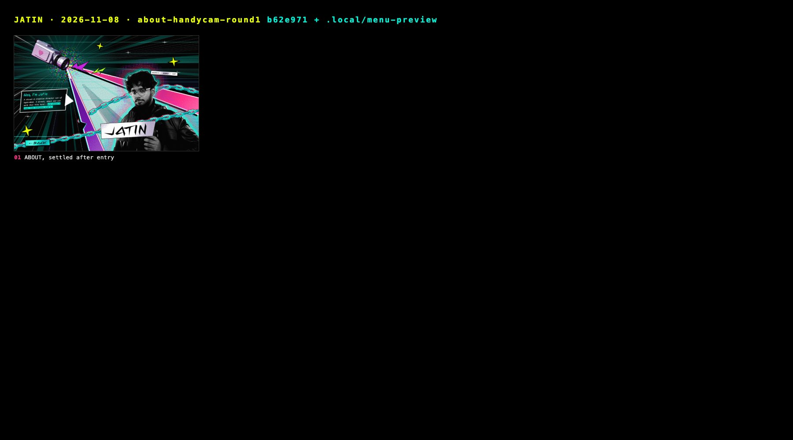

# Stills: 2026-11-08 · about-handycam-round1

Captured 2026-11-08 from `b62e971 + .local/menu-preview` with `docs/tools/snap.mjs` (Comet, Chrome 156.0.8078.48, headless).
Desktop 1440×900 @1x, phone 375×812 @2x. Generated file: re-run the tool rather than editing it;
the story behind these frames is in [../../JOURNAL.md](../../JOURNAL.md).

| # | Still | Moment |
|---|---|---|
| 01 | [01-about.jpg](01-about.jpg) | ABOUT, settled after entry |

## Added by hand

| Still | Moment |
|---|---|
| [10-entrance-sheet.jpg](10-entrance-sheet.jpg) | Entrance at 450 / 700 / 900 / 1000 / 1150 / 1400ms: camera swings in, beam shoots out of the lens, he lands, words pop |
| [11-camera-close.jpg](11-camera-close.jpg) | The handycam up close (before the final size bump) |
