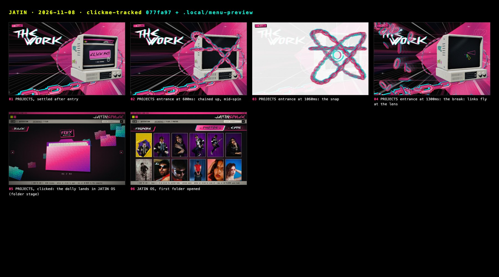

# Stills: 2026-11-08 · clickme-tracked

Captured 2026-11-08 from `077fa97 + .local/menu-preview` with `docs/tools/snap.mjs` (Comet, Chrome 156.0.8078.48, headless).
Desktop 1440×900 @1x, phone 375×812 @2x. Generated file: re-run the tool rather than editing it;
the story behind these frames is in [../../JOURNAL.md](../../JOURNAL.md).

| # | Still | Moment |
|---|---|---|
| 01 | [02-projects.jpg](02-projects.jpg) | PROJECTS, settled after entry |
| 02 | [02-projects-600ms.jpg](02-projects-600ms.jpg) | PROJECTS entrance at 600ms: chained up, mid-spin |
| 03 | [02-projects-1060ms.jpg](02-projects-1060ms.jpg) | PROJECTS entrance at 1060ms: the snap |
| 04 | [02-projects-1300ms.jpg](02-projects-1300ms.jpg) | PROJECTS entrance at 1300ms: the break: links fly at the lens |
| 05 | [02-projects-os.jpg](02-projects-os.jpg) | PROJECTS, clicked: the dolly lands in JATIN OS (folder stage) |
| 06 | [02-projects-os-folder.jpg](02-projects-os-folder.jpg) | JATIN OS, first folder opened |
