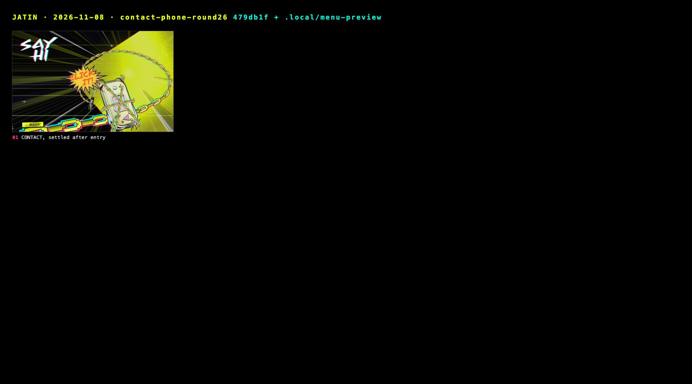

# Stills: 2026-11-08 · contact-phone-round26

Captured 2026-11-08 from `479db1f + .local/menu-preview` with `docs/tools/snap.mjs` (Comet, Chrome 156.0.8078.48, headless).
Desktop 1440×900 @1x, phone 375×812 @2x. Generated file: re-run the tool rather than editing it;
the story behind these frames is in [../../JOURNAL.md](../../JOURNAL.md).

| # | Still | Moment |
|---|---|---|
| 01 | [04-contact.jpg](04-contact.jpg) | CONTACT, settled after entry |

## Added by hand (Playwright run of the CONTACT flow, 1440×900 and 375×812)

| Still | Moment |
|---|---|
| [10-ring-click-it.jpg](10-ring-click-it.jpg) | Ringing, chained: the CLICK IT! balloon in the reference's style |
| [11-buzz-click-again.jpg](11-buzz-click-again.jpg) | Chains gone, buzzing: the CLICK AGAIN! arrow |
| [12-lcd-idea.jpg](12-lcd-idea.jpg) | Answered: the chat is drawn on the model's own LCD |
| [13-lcd-who.jpg](13-lcd-who.jpg) | Typing straight onto the LCD |
| [14-lcd-review.jpg](14-lcd-review.jpg) | Read-back before sending |
| [15-phone-375-flow.jpg](15-phone-375-flow.jpg) | Whole flow at 375×812 |
| [16-lcd-flow-sheet.jpg](16-lcd-flow-sheet.jpg) | Every LCD screen, desktop crops |
