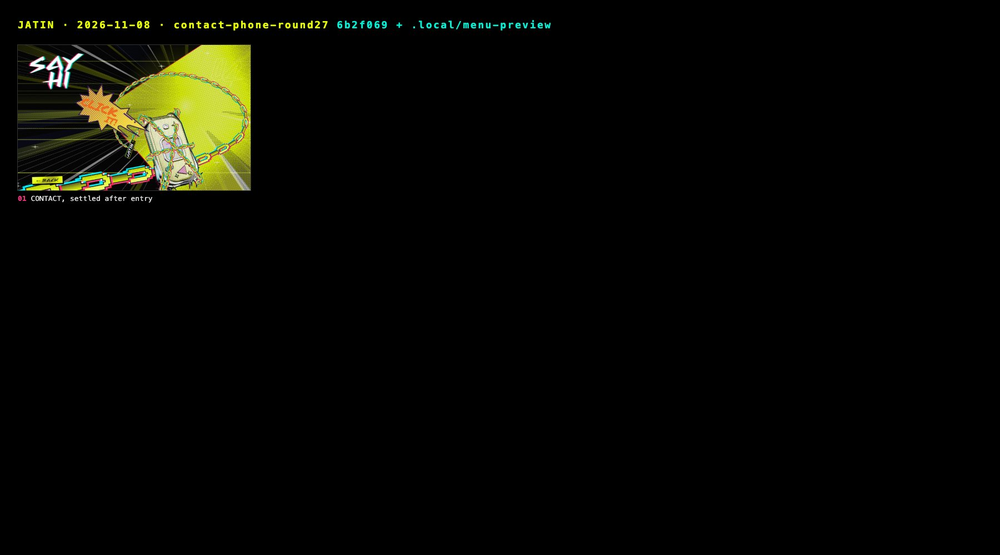

# Stills: 2026-11-08 · contact-phone-round27

Captured 2026-11-08 from `6b2f069 + .local/menu-preview` with `docs/tools/snap.mjs` (Comet, Chrome 156.0.8078.48, headless).
Desktop 1440×900 @1x, phone 375×812 @2x. Generated file: re-run the tool rather than editing it;
the story behind these frames is in [../../JOURNAL.md](../../JOURNAL.md).

| # | Still | Moment |
|---|---|---|
| 01 | [04-contact.jpg](04-contact.jpg) | CONTACT, settled after entry |

## Added by hand (Playwright run of the CONTACT entrance, 1440×900 and 375×812)

| Still | Moment |
|---|---|
| [10-ring-click-it.jpg](10-ring-click-it.jpg) | Shut, chained, ringing: the tapering CLICK IT! burst |
| [11-click1-lid-bursts-chains.jpg](11-click1-lid-bursts-chains.jpg) | Click 1, +110ms: the lid flips open and bursts the chains |
| [12-open-screen-on.jpg](12-open-screen-on.jpg) | Open, the screen on |
| [13-buzz-click-again.jpg](13-buzz-click-again.jpg) | Buzzing, 1 NEW MESSAGE on the LCD, the mirrored CLICK AGAIN! burst |
| [14-click2-close.jpg](14-click2-close.jpg) | Click 2: it has come up close, the chat on its LCD |
| [15-375-ring.jpg](15-375-ring.jpg) / [16-375-buzz.jpg](16-375-buzz.jpg) | Phone width |
